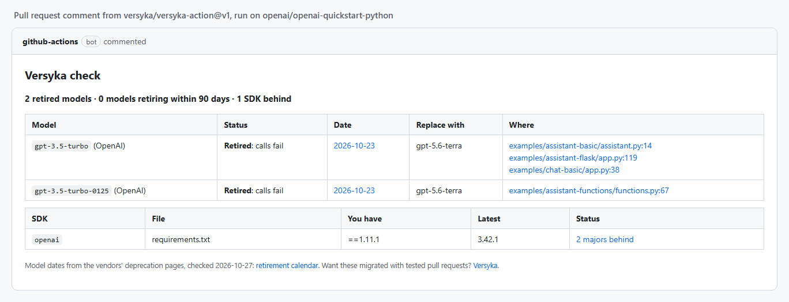

# Versyka: AI model retirements and SDK upgrades

**Catch retired AI models and outdated API SDKs in every pull request, before calls start failing.**

[](https://github.com/versyka/versyka-action/actions/workflows/ci.yml)
[](https://github.com/marketplace/actions/versyka-ai-model-retirements-and-sdk-upgrades)
[](LICENSE)



*A real run on OpenAI's own quickstart repo, which still calls `gpt-3.5-turbo` after OpenAI stopped serving it on 2026-10-23.*

**Try it without installing anything:** paste any public repository into the [free repository check](https://www.versyka.com/model-retirements#check).

A GitHub Action that catches two things before they break production:

- **AI model IDs that are retired or retiring.** OpenAI, Anthropic, Google Gemini, Mistral and Cohere retire models on fixed dates, and so do platforms that host them: Amazon Bedrock and Groq. Calls to a retired model start failing. The action finds every model ID in your code and config, including Vertex AI, LiteLLM and OpenRouter spellings, and reports the date, the replacement and each file and line. Bedrock IDs (`anthropic.claude-…-v1:0`, `meta.llama3-…-v1:0`) get Bedrock's own dates, which can differ from the model maker's.
- **API SDKs that are major versions behind** (OpenAI, Anthropic, Stripe, AWS, Twilio and 100+ API vendors on npm and PyPI), with release notes and migration guides.

It writes a job summary, annotates the lines in the pull request diff, and leaves one pull request comment that it updates on every push.

## Usage

Add one file to your repository:

```yaml
# .github/workflows/versyka.yml
name: Versyka
on:
  pull_request:
  schedule:
    - cron: "0 9 * * 1" # weekly, so approaching dates are caught too
permissions:
  contents: read
  pull-requests: write # for the comment; remove to only write the job summary
jobs:
  check:
    runs-on: ubuntu-latest
    steps:
      - uses: actions/checkout@v5
      - uses: versyka/versyka-action@v1
        with:
          fail-on: retired
```

## Inputs

| Input | Default | What it does |
| --- | --- | --- |
| `fail-on` | `retired` | `none`, `retired` (a model that no longer works), `soon` (retiring within `days`), or `behind` (also an SDK major versions behind or deprecated). |
| `days` | `90` | How many days ahead counts as "soon". |
| `comment` | `true` | Comment on the pull request (updated in place, never repeated). |
| `path` | `.` | The folder to check. |
| `github-token` | `github.token` | Token used to comment. |

Outputs: `retired`, `soon`, `behind`.

## Privacy

Your source code never leaves the runner. The model scan runs on the runner against the public list at https://www.versyka.com/api/model-retirements. Only dependency manifests (package.json, requirements*.txt, pyproject.toml, Pipfile) are sent to the Versyka upgrade check, which reads package names and versions and stores nothing.

## Contributing

Bug reports, missed model IDs and false alarms are the most useful thing you can send: [open an issue](https://github.com/versyka/versyka-action/issues/new/choose). Questions and ideas go in [Discussions](https://github.com/versyka/versyka-action/discussions). See [CONTRIBUTING.md](CONTRIBUTING.md) to send a pull request; issues labelled [good first issue](https://github.com/versyka/versyka-action/labels/good%20first%20issue) are a good place to start.

## Also

- The calendar: https://www.versyka.com/model-retirements (with an iCalendar feed)
- The MCP server for coding agents: https://www.versyka.com/integrations#mcp
- Tested migration pull requests: https://www.versyka.com

MIT licensed.
